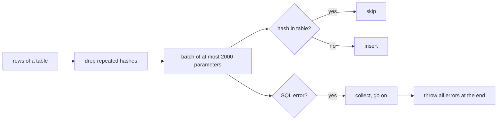

<!--
@license
Copyright (c) rljson

Use of this source code is governed by terms that can be
found in the LICENSE file in the root of this package.
-->

# Skip existing rows instead of aborting the table write

## Motivation

- Rljson rows are content-addressed: the `_hash` is the primary key of
  every table. Writing two data sets that share rows into one database is
  therefore normal, for example one data set after another into the same
  schema.
- `write()` lost data in exactly that case. As soon as one row of a batch
  already existed, SQL Server rejected the batch with a duplicate key
  (error 2627) and `write()` returned from the table without an error.
- The rows of that batch and of all later batches of the table were never
  written, and nobody noticed.

## Strategy

- Treat an existing row as written: same hash, same content.
- Let SQL Server skip existing rows instead of failing on them.
- Never leave a table early; report real errors after all batches ran.
- Reproduce the loss in a test before fixing it.

## Insert only missing rows

- Every batch is now an `INSERT … SELECT … FROM (VALUES …)` with
  `WHERE NOT EXISTS` on the hash column.
- The hashes are compared with `COLLATE Latin1_General_BIN2`, so the
  comparison is case-sensitive whatever the collation of the column is.
- Rows that appear twice in one `write()` are written once; before, the
  repeated row failed its own batch.
- The batch size stays below the 2100 parameter limit of SQL Server.

## Do not stop at a failing batch

- A batch that fails for another reason no longer ends the table write.
  Its error is collected and the next batch runs.
- `write()` throws once at the end with all collected errors.

## Tests

- Overlapping writes: 10 rows, then 2500 rows that contain the 10. All 2500
  rows are stored; the old code stored only the first 10.
- Repeated rows within one write are stored once.
- Writing the same rows again leaves the table unchanged.
- `vitest.config.mts` now also runs `*.test.ts`, so the generated version
  test runs and coverage reaches 100 % again.

## Conformance tests

- `scripts/install-conformance-tests.js` deploys the conformance tests from
  a linked local checkout of `@rljson/io` when there is one.
- The conformance tests now cover the optional `readRowsByHashes`.
  `IoMssql` does not implement it, so these cases are skipped.

## Dependency updates

- `@rljson/io` 0.0.79 → 0.0.88, `@rljson/rljson` 0.0.81 → 0.0.89,
  `@rljson/hash` and `@rljson/is-ready` → 0.0.21, `mssql` → 12.7.14,
  `stream-json` → 3.9.0. All tests pass on them.
- The rljson DNA brings new scripts (`check-readme.js`,
  `setup-github-repo.js`) and updated guides.
- New `index.jsonc` describes the repo for planning.

## Open Points

- The hash column keeps the case-insensitive collation of the database.
  Two hashes that differ only in case now fail with an error instead of
  getting lost; a binary collation for hash columns is a separate change.
- Databases written with the old code miss rows and need a new import.
- `IoMssql` could implement `readRowsByHashes`.
