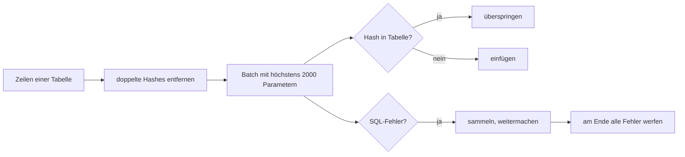

<!--
@license
Copyright (c) rljson

Use of this source code is governed by terms that can be
found in the LICENSE file in the root of this package.
-->

# Vorhandene Zeilen überspringen, statt das Schreiben der Tabelle abzubrechen

## Motivation

- Rljson-Zeilen sind inhaltsadressiert: Der `_hash` ist der Primärschlüssel
  jeder Tabelle. Zwei Datensätze mit gemeinsamen Zeilen in eine Datenbank zu
  schreiben ist daher normal, zum Beispiel einen Datensatz nach dem anderen
  in dasselbe Schema.
- Genau dann verlor `write()` Daten. Sobald eine Zeile eines Batches schon
  existierte, lehnte SQL Server den Batch mit einem doppelten Schlüssel ab
  (Fehler 2627), und `write()` verließ die Tabelle ohne Fehler.
- Die Zeilen dieses Batches und aller späteren Batches der Tabelle wurden
  nie geschrieben, und niemand hat es bemerkt.

## Strategie

- Eine vorhandene Zeile gilt als geschrieben: gleicher Hash, gleicher
  Inhalt.
- SQL Server überspringt vorhandene Zeilen, statt an ihnen zu scheitern.
- Eine Tabelle nie vorzeitig verlassen; echte Fehler erst melden, wenn alle
  Batches gelaufen sind.
- Den Verlust in einem Test nachstellen, bevor er behoben wird.

## Nur fehlende Zeilen einfügen

- Jeder Batch ist jetzt ein `INSERT … SELECT … FROM (VALUES …)` mit
  `WHERE NOT EXISTS` auf der Hash-Spalte.
- Die Hashes werden mit `COLLATE Latin1_General_BIN2` verglichen; der
  Vergleich beachtet also Groß- und Kleinschreibung, egal welche Collation
  die Spalte hat.
- Zeilen, die in einem `write()` doppelt vorkommen, werden einmal
  geschrieben; vorher ließ die doppelte Zeile ihren eigenen Batch scheitern.
- Die Batchgröße bleibt unter dem Limit von 2100 Parametern.

## Bei einem fehlerhaften Batch nicht aufhören

- Ein Batch, der aus einem anderen Grund scheitert, beendet das Schreiben
  der Tabelle nicht mehr. Sein Fehler wird gesammelt, der nächste Batch
  läuft.
- `write()` wirft am Ende einmal mit allen gesammelten Fehlern.

## Tests

- Überlappendes Schreiben: 10 Zeilen, dann 2500 Zeilen, die die 10
  enthalten. Alle 2500 Zeilen landen in der Tabelle; der alte Code
  speicherte nur die ersten 10.
- Doppelte Zeilen innerhalb eines Schreibvorgangs werden einmal
  gespeichert.
- Dieselben Zeilen erneut zu schreiben, lässt die Tabelle unverändert.
- `vitest.config.mts` führt jetzt auch `*.test.ts` aus, damit der
  generierte Versionstest läuft und die Abdeckung wieder 100 % erreicht.

## Konformitätstests

- `scripts/install-conformance-tests.js` stellt die Konformitätstests aus
  einem verlinkten lokalen Checkout von `@rljson/io` bereit, wenn es einen
  gibt.
- Die Konformitätstests decken jetzt das optionale `readRowsByHashes` ab.
  `IoMssql` implementiert es nicht, diese Fälle werden übersprungen.

## Aktualisierte Abhängigkeiten

- `@rljson/io` 0.0.79 → 0.0.88, `@rljson/rljson` 0.0.81 → 0.0.89,
  `@rljson/hash` und `@rljson/is-ready` → 0.0.21, `mssql` → 12.7.14,
  `stream-json` → 3.9.0. Alle Tests laufen damit.
- Die rljson-DNA bringt neue Skripte (`check-readme.js`,
  `setup-github-repo.js`) und aktualisierte Guides.
- Die neue `index.jsonc` beschreibt das Repo für die Planung.

## Offene Punkte

- Die Hash-Spalte behält die Collation der Datenbank, die Groß- und
  Kleinschreibung ignoriert. Zwei Hashes, die sich nur darin unterscheiden,
  scheitern jetzt mit einem Fehler, statt verloren zu gehen; eine binäre
  Collation für Hash-Spalten ist eine eigene Änderung.
- In Datenbanken, die mit dem alten Code geschrieben wurden, fehlen Zeilen;
  sie brauchen einen neuen Import.
- `IoMssql` könnte `readRowsByHashes` implementieren.
